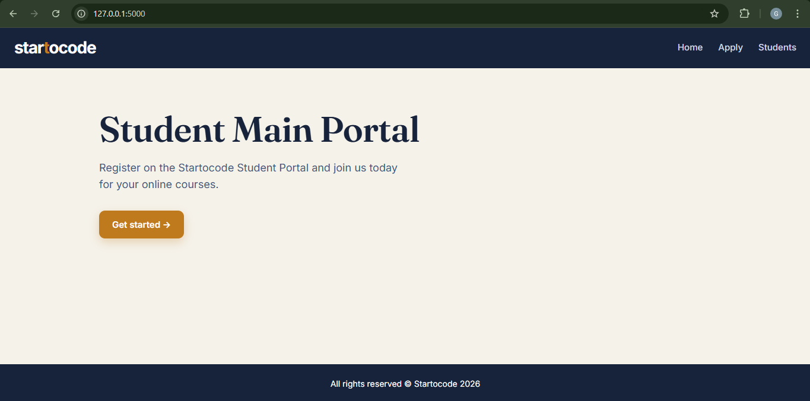
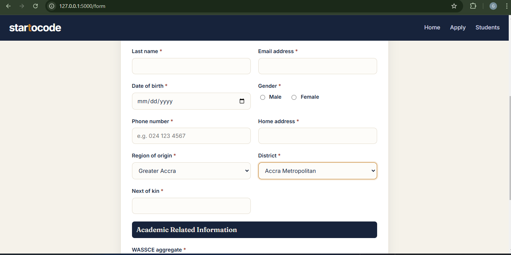
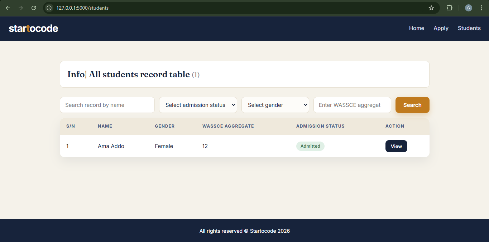
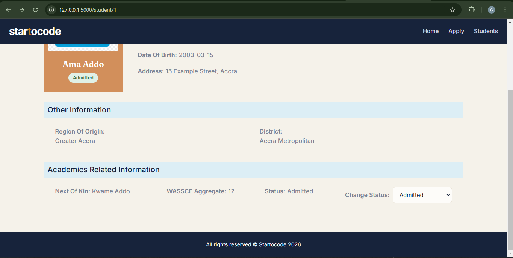

# Students' Portal: Fullstack Python Capstone (Ghana Edition)

A Flask web application where students submit their personal and academic
details. Records are stored in a SQLite database, the uploaded photo is saved
to a folder (only its filename goes in the database), every student is listed
in a searchable table, and each student has a details page with an admission
status you can change **without reloading the page**.

The Region of Origin and District select boxes are populated asynchronously
with **Ghana's 16 administrative regions and their 261 districts (MMDAs)**.
Choosing a region loads only that region's districts.


## Application Screenshots

### Home Page


### Student Registration


### Student Directory


### Student Details and Admission Status

  
## Features (mapped to the brief)

| Requirement | Where it lives |
|---|---|
| Consistent header/footer + nav on every page | `templates/base.html` |
| Landing page with call-to-action to the form | `templates/index.html` |
| Form with file, text, email, date, number, select and radio inputs | `templates/form.html` |
| Selects populated with **async JavaScript** (Region to District) | `static/js/form.js` + `/api/regions`, `/api/districts/<region>` |
| Submit saves to DB, redirects to the students table | `app.py` (`/submit`) |
| Image saved to folder, filename saved in DB | `app.py` (`save_photo()`) |
| Table of all students with a View button per row | `templates/students.html` |
| Details page shows the full record incl. the photo | `templates/details.html` |
| Admission status changed **asynchronously** | `static/js/details.js` + `/api/student/<id>/status` |

Extras beyond the brief:

- Live filters on the students table: search by name, admission status,
  gender and WASSCE aggregate (`static/js/table.js`)
- Student count in the table heading
- Footer year that updates itself
- Server-side validation (required fields, image type, 5 MB limit,
  aggregate between 6 and 54, district must belong to the chosen region)

## Project structure

```
Ghana-Student-Portal/
├── app.py                  # Flask app: routes, DB, image handling, JSON API
├── build_regions.py        # one-off script that writes static/data/regions.json
├── requirements.txt
├── instance/
│   └── portal.db           # SQLite DB (created automatically, not committed)
├── static/
│   ├── css/style.css
│   ├── js/form.js          # async region/district selects + validation
│   ├── js/details.js       # async admission-status update
│   ├── js/table.js         # filters on the students table
│   ├── data/regions.json   # 16 regions + 261 districts (the select-box data)
│   └── uploads/            # uploaded student photos land here (not committed)
└── templates/
    ├── base.html           # navbar + footer, shared by all pages
    ├── index.html          # landing page
    ├── form.html           # portal form
    ├── students.html       # students table
    └── details.html        # single student record
```

## How to run

You need Python 3.10+.

```bash
# 1. clone the repo and move into it
git clone https://github.com/GRACE-AFFUL/Ghana-Student-Portal.git
cd Ghana-Student-Portal

# 2. (optional but recommended) create a virtual environment
python -m venv venv
source venv/bin/activate        # Windows: venv\Scripts\activate

# 3. install Flask
pip install -r requirements.txt

# 4. start the server and leave this terminal open
python app.py
```

When you see `Running on http://127.0.0.1:5000`, open
<http://127.0.0.1:5000> in your browser.

The database and its table are created automatically on first run, so there
is no separate setup step.

## Troubleshooting

**"ERR_CONNECTION_REFUSED" at `http://127.0.0.1:5000`**
The Flask server is not running. The browser page only works while
`python app.py` is running in a terminal. Start it again (step 4 above), keep
that terminal open, then refresh the page. If the terminal shows an error
such as `ModuleNotFoundError: No module named 'flask'`, activate your virtual
environment and run `pip install -r requirements.txt` first.

**"Address already in use"**
Another copy of the app is already running. Close the other terminal, or
stop it with `Ctrl + C`.

## Notes

- **Region/district data** lives in `static/data/regions.json` as an array of
  objects: `[ { "region": "...", "districts": [ ... ] }, ... ]`. District
  boundaries do change from time to time, so if your official list differs,
  edit `build_regions.py` and run `python build_regions.py` to regenerate
  the JSON.
- **WASSCE aggregate** accepts 6 (best possible, six A1s) through 54.
- **Uploaded photos** are saved in `static/uploads/` with a unique prefix so
  two files with the same name never overwrite each other.
- The application reads `SECRET_KEY` from an environment variable, with a fallback intended for local development only. Flask debug mode is disabled. Before production deployment, configure a strong, private `SECRET_KEY` and review the application's security settings.
